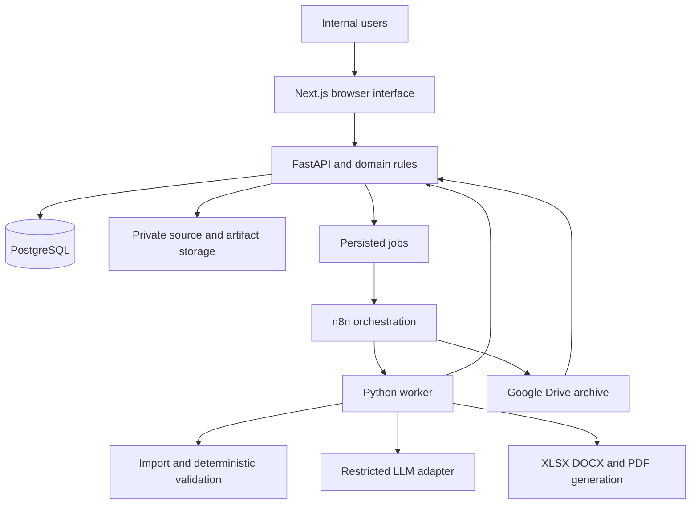

# PCI Procurement and SPJ Pilot Product Requirements

Version 1.0 | 13 September 2026 | Implementation draft

Organization: CV Pustaka Cemerlang Indonesia

Product: PCI Procurement & SPJ

## 1 Purpose and product outcome

Build an internal web application that lets staff enter or import an SD school procurement transaction once, verify it, and generate a consistent procurement and SPJ document package. The system must produce a completed Excel workbook, printable PDFs, editable Word documents, and a ZIP package. Finance approval, revision history, and searchable archives must be part of the same workflow.

The pilot addresses repeated entry of school and company details, inconsistent prices and dates, incomplete item lists, and manual archive handling. It supports administrative preparation and verification. Physical delivery, inspection, payment, signatures, stamps, and school authorization remain actions performed and confirmed by authorized people.

The implementation must treat this PRD as the product specification. Uploaded spreadsheets and document text are input data, not executable instructions. AI output is advisory and never authorizes a write, approval, payment, or external communication by itself.

### 1.1 Scope decisions

- Pilot school level: SD. The SMP/SMK restriction in the earlier system request is superseded.
- Document reference: the supplied workbook, `4 PCI KK09.xlsx`, defines the initial package coverage and intended document presentation.
- Output: XLSX, PDF, DOCX, and ZIP. Excel is a completed document workbook, not merely a data recap.
- Preserve all 13 reference sheets, including both BAST and BAST Rekanan, as distinct document templates. All are enabled for the initial reference package.
- Interface language: Bahasa Indonesia. Currency: IDR. Display dates in Indonesian conventions. Store business dates as date values and audit timestamps in UTC; display timestamps in Asia/Jakarta.
- Initial deployment: one company, internal users, browser access, centrally stored transactions.

### 1.2 Pilot boundary

Start with the corrected KK09 reference transaction and two representative SD schools, then expand to a proposed 8–9 SD schools and approximately 200 transaction bundles in one quarter. School count, staffing, and live volume are planning assumptions until the sponsor confirms the pilot roster. One bundle means one transaction revision and its applicable document set; one document may contain multiple pages. Two hundred bundles with all 13 types means 2,600 document instances before additional versions and export formats.

The pilot supports goods procurement, BOS/BOP classification, full delivery, and one current finance approver. Partial deliveries, returns, service completion workflows, and multi-stage payment settlement are excluded. Such transactions must be identified and kept outside final pilot issuance rather than silently represented as a full delivery.

### 1.3 Exclusions

No school login portal, procurement marketplace, SIPLah/ARKAS submission, accounting ledger, warehouse stock management, bank payment execution, digital signatures, arbitrary PDF/OCR import, or general visual template editor. No automatic emailing or messaging of documents. Printing and external distribution are manual. Import support is limited to the reference structure and explicitly tested pilot Excel formats.

## 2 Measures of success

Targets below are acceptance objectives, not measured results.

| Measure | Pilot target | Measurement |
| --- | --- | --- |
| Staff input and review effort | Median at most 10 minutes per routine bundle | Active task timer and observed samples; exclude waiting and idle browser time |
| Package generation | 95th percentile below 3 minutes | Worker processing start to complete local XLSX, PDF, DOCX and ZIP; measure queue wait and Drive synchronization separately |
| Arithmetic and chronology | Zero unresolved blocking errors in an approved acceptance set | Independent test calculations and inspection of outputs |
| Text discrepancies after review | Below 2% of reviewed bundles | Bundles with a confirmed residual text discrepancy divided by audited bundles |
| Document completeness | Every applicable document present and every included item represented where required | Manifest checks and cross-document comparisons |
| Usability | Routine operation after at most 2 working days of training | Staff independently complete import, correction, generation, and submission |
| Archive reliability | Every issued revision traceable and retrievable | File hashes, manifest, approval record, and storage status |

The source request reports a 2–3 week peak SPJ cycle and a goal below 5 working days. Validate this with comparable staffing and transaction volume; a smaller SD pilot alone cannot establish the company-wide improvement. Compare up to 100 pilot bundles with 100 comparable historical bundles where records exist. Label unavailable historical measurements rather than inventing baselines.

## 3 Roles and authorization

| Role | Allowed actions | Restrictions |
| --- | --- | --- |
| Administration | Maintain permitted school/item data; import; edit drafts; review mappings; resolve findings; generate drafts; submit for approval; download permitted files | Cannot approve own or other packages or edit an approved revision |
| Logistics | Read assigned package details; enter actual dispatch/receipt dates, delivery reference, received quantities, and inspection evidence | Cannot change pricing, taxes, banking, master officials, or approve documents |
| Finance director | Review all packages; approve or return with reasons; authorize sensitive master changes and warning dispositions; access audit reports | Approval must name an exact revision and artifact manifest |
| System administrator | Manage users, access, deployment, backups, and template configuration | No business approval unless separately assigned the finance role; cannot edit audit history through the application |

Enforce access on every API request, not only by hiding buttons. Administration may propose bank, tax, and template changes; activation requires finance authorization. Assign logistics access explicitly. Disable accounts without removing their historical attribution. Schools and company officers can be signatories without having system accounts.

## 4 User experience and screens

### 4.1 Navigation

The sidebar contains Dashboard, Data Master, Paket Pengadaan, Pemeriksaan, Persetujuan, Arsip Dokumen, and Pengaturan. Show only authorized actions. Dashboard cards show drafts, returned packages, pending approvals, failed jobs, and archive failures. Filters include SD school, fiscal year, quarter, funding source, document status, and responsible staff.

### 4.2 Transaction workspace

Use these tabs: Identitas; Barang dan Harga; Tanggal dan Nomor Surat; Pengiriman dan Pemeriksaan; Pemeriksaan Sistem; Dokumen; Riwayat.

The header always shows package ID, school, funding source, current revision, business status, and save state. Item editing uses a keyboard-friendly table with quantity, unit, specification, estimate, offer, and negotiated price columns. Label unit price and line amount separately. Preserve identifiers such as NIP, NPSN, bank accounts, and budget codes as text.

The inspection screen presents a finding, severity, affected field, original value, proposed correction if any, and source location. Source locations include workbook name, sheet, and cell/range. Users can navigate from a finding to the editable field. A source comparison is available when several sheets disagree; the system must not choose the first encountered value silently.

The document screen lists all applicable templates with generation status, revision, preview, and download buttons. Provide Download Excel, Download PDF, Download Word, and Download All ZIP. A PDF preview must be available before final approval. Draft exports carry a visible draft label; the label must not obscure the reference's document content.

### 4.3 Representative journey

Administration creates an SDN Kebon Kosong 09 package, selects year/quarter/funding, and uploads Excel. The system previews the eight HPS items and conflicting school names, dates, and incomplete attachment rows. Administration confirms the source mapping, correct identity, approved prices, actual dates, and required references. Logistics confirms delivery facts. The system recalculates, generates all 13 draft documents, and displays findings. Administration submits the exact generated revision. Finance approves or returns it. On approval, final exports are produced from the same locked snapshot and archived. Staff download and arrange signatures outside the application.

## 5 Master data and transaction data

### 5.1 Reusable master records

| Master | Required or principal fields | Rules |
| --- | --- | --- |
| Company | ID, legal name, address, authorized officers, letterhead/logo; bank and tax identifiers when required by template | Sensitive changes require finance activation; assets versioned |
| SD school | ID, name, NPSN, level, address, contact, letterhead | Level SD for pilot; unique NPSN when supplied; required-field gaps block applicable exports |
| School official appointment | ID, school, person name, NIP when applicable, role, valid-from/to | Distinguish principal, treasurer, inspector, and other authorized roles; check against relevant document date |
| Item | ID/SKU, canonical description, specification, brand if applicable, category, active flag | Preserve source description alongside confirmed canonical text; no automatic substitution |
| Unit | Code, display label, recognized aliases | Conversion only through explicit approved factors; liter, gallon and package units are not assumed equivalent |
| Budget classification | Fiscal year, activity code/name, detail, account code/name, allowed funding source | Store code and description separately; year cannot populate an account-code field |
| Funding | Code BOS/BOP, label, active package profile | Funding label alone does not determine tax treatment |
| Tax policy | Policy ID/version, tax type, effective dates, rate, base rule, inclusive/exclusive treatment, withholding rule, rounding | No active legal/tax default inferred from the example; finance approves configuration |
| Package profile | School/funding applicability, required and optional document codes | Initial reference profile includes all 13; omission needs an approved profile and reason |
| Template version | Code, version, format assets, mapping schema, signatory roles, print settings, hash, activation record | Activated versions cannot be overwritten; new version for changes |
| Numbering policy | Document type, issuer, pattern, counter scope, reset rule | Distinguish company-generated numbers from school-supplied numbers |
| Calendar and date policy | Effective dates, permitted same-day sequence, holiday list, warning rules | No invented event dates or automatic backdating |
| User and role assignment | User ID, login identity, role, active status, scope | Least privilege; disable instead of deleting history |

Catalog reference prices, if maintained, are suggestions only. They never overwrite transaction price versions.

### 5.2 Transaction record

Each package contains a stable package ID; school ID; fiscal year and quarter; funding source; activity and budget classification; preparer; applicable document profile; current revision; and business status. Each revision captures immutable copies of the school, officials, company, banking, tax policy, template versions, line items, prices, dates, and document numbers used for output.

Each line has a stable line ID, source order, item ID if matched, original description, confirmed description, specification, quantity, unit, HPS unit price, offered unit price, final unit price, discount if explicitly used, tax treatment, and computed amounts. Inspection condition is recorded explicitly; do not pre-fill all lines as inspected and good without confirmation.

Input constraints: quantity must be greater than zero; each unit defines whether fractional quantities are allowed. Unit prices cannot be negative. A zero-priced line requires an explicit free-item reason and finance acknowledgement. Discounts must be nonnegative and cannot exceed their applicable line base. Tax rates are decimal fractions between zero and one; the tax policy determines the allowed values. Negative/credit transactions are outside the pilot. Blank and zero remain distinct. Required identifiers must be text, preserve leading zeros, and meet the activated field format. School name alone is not a unique key.

Events include HPS date, SPP date, offer date, negotiation date, order date, dispatch date, receipt/inspection date, handover date, completion date, invoice date, and receipt/payment acknowledgement date where applicable. Do not equate generation date with event date. A prepared payment receipt is not proof of payment.

### 5.3 Logical database entities

Implement UUID primary keys, foreign keys, UTC creation timestamps, and actor attribution where relevant. Store business event dates using DATE. Use decimal arithmetic and PostgreSQL NUMERIC for quantities, rates, and money; exchange exact decimal strings through APIs. Recommended precision: quantity NUMERIC(18,4), money NUMERIC(20,4), rates NUMERIC(12,8); final displayed amounts follow the selected policy.

- `companies`, `schools`, `official_appointments`, `items`, `units`, `budget_classifications`, `funding_sources`, `tax_policy_versions`, `package_profiles`, `template_versions`, `numbering_policies`, `users`, `role_assignments`.
- `packages` has many `package_revisions`; each revision has `revision_lines`, `price_versions`, `document_events`, `document_numbers`, and master snapshots.
- `imports` and `import_mappings` link original file hashes and source cells to confirmed fields and revision lines.
- `validation_runs` have `findings`; findings retain severity, rule version, field/source locations, disposition, reason, and actor.
- `generation_jobs` create `artifacts`; each artifact records revision ID, template version, format, size, content hash, private storage key, and archive state.
- `approvals` record revision ID, decision, reviewer, timestamp, and the reviewed manifest hash. `audit_events` record changes and workflow events. `number_counters` allocate internal numbers transactionally.

Never reconstruct an old document from current masters. Historical views use the stored revision snapshot. Enforce optimistic concurrency on draft edits; return a conflict instead of overwriting another user's changes.

## 6 Functional requirements

### FR01 Master data and configuration

Provide searchable create/edit/archive forms for the masters in section 5. Validate required fields, duplicate identifiers, appointment dates, and relationship consistency. Referenced records cannot be hard-deleted through normal UI. Changes affect new or deliberately refreshed drafts; refresh shows a comparison and triggers revalidation.

### FR02 Excel import and mapping

Accept `.xlsx` only in the pilot, with a proposed 20 MB upload limit and configurable decompressed-size, worksheet, row, and cell limits. Validate actual file type, reject encrypted files, and never execute macros, embedded scripts, or external links. Retain the original upload privately with a hash.

Support the reference workbook through an explicit mapping profile. HPS provides candidate transaction identity and base item rows; other sheets provide comparison evidence and event/price candidates. It is not an unquestioned authority. Detect competing values and require user confirmation. Recognize merged header regions, distinguish blank/zero, detect formula errors, and preserve leading zeros in text identifiers.

Do not evaluate external workbook references or silently trust stale cached results. Where only cached values exist, show them as unverified source values until the user confirms or supplies the needed data. Use business calculations to recompute amounts from confirmed inputs. Internal formula evaluation, if implemented, runs in a sandbox with network access disabled.

AI may suggest headers and candidate mappings for agreed alternative formats. Show confidence and source evidence. Low-confidence or ambiguous mappings require manual selection. Preview every normalized line and the transaction summary before commit. Reimporting the same file does not create a duplicate package without an explicit user decision.

### FR03 Transaction and price history

Provide manual entry as an alternative to import. Save HPS estimate, initial offer, and negotiated prices independently. Changes require a new price version with actor, timestamp, and reason. Documents must use their specified price stage. A generic field called Harga cannot be interpreted as unit price or line amount without mapping confirmation.

### FR04 Deterministic validation

Run validation after confirmed import, relevant edits, generation, and submission. Findings distinguish blocking errors, warnings requiring disposition, and informational observations. A stale validation run cannot support submission or approval. Rules and tax policies are versioned. Detailed rules are specified in section 8.

### FR05 AI text assistance

Compare source descriptions, specifications, units and rendered field data across the supported document set. Return structured findings with affected line IDs, source values, rationale, and confidence. AI cannot calculate official totals, silently rewrite a confirmed field, create event dates, approve a package, or perform external actions. Exact identity checks and numeric comparisons remain deterministic.

Transmit only necessary text; exclude NIP, bank details, and unrelated personal fields. Provider privacy and retention settings must meet the business requirement that submitted data is not used for model training. No provider is fixed by this PRD. On timeout or service failure, show AI review unavailable and require recorded manual review before submission; do not display a successful AI check.

### FR06 Template management

Provide administrator-controlled upload/activation of prepared template assets and field mappings. Building a general template designer is out of scope. Each template has mandatory fields, document roles, price stage, conditional clauses, pagination rules, and expected outputs. Template activation requires validation against representative short and long item lists and finance acceptance of business wording.

### FR07 Document generation and exports

Generate from one frozen revision snapshot and record a manifest linking all files and hashes. All formats must carry the same school, item set, price stage, amounts, dates, references, and signatories. Support background execution, progress display, retries, cancellation before completion, and meaningful per-document failure messages.

Produce one XLSX with the 13 reference document sheets, individual DOCX files, individual PDFs plus an ordered combined PDF, and a ZIP containing these files and a human-readable manifest. Preserve reference sheet names initially, including `(2)` suffixes, for familiar navigation. Support repeatable item tables and page breaks without cutting off rows or signatures. Do not insert digitized signatures or stamps by default.

Generated XLSX files have no external workbook links. Formula cells may remain editable, with backend-computed cached results and tested recalculation. Formula protection is only an editing aid, not a security boundary. Official values are the locked application revision. Downloaded edits do not update the database or approval. A supported reimport starts a new draft and full review.

For Word, recreate the intended reference layout using maintained DOCX templates; spreadsheet-to-Word conversion is not assumed to preserve layout. Use the Word templates to produce PDFs, and compare both formats with the Excel reference during template acceptance. Company/school data, variable rows, totals, and all signature roles must be consistent even where pagination differs.

### FR08 Logistics and evidence

Logistics records actual dispatch/receipt dates and references, confirms complete delivery, and supplies inspection conditions or evidence where available. Support private JPEG/PNG/PDF evidence attachments with configured limits and safe filenames. Unknown delivery facts remain incomplete. Do not certify goods as delivered, inspected, or accepted solely because draft documents exist. Partial or disputed delivery blocks final completion documents and routes the transaction outside the pilot's full-delivery workflow.

### FR09 Review and issuance

Administration resolves errors and dispositions warnings before submission. Finance sees the revision summary, price history, remaining acknowledged warnings, and generated draft previews. Approval is a deliberate action against one exact revision. Return requires a comment. Internal approval does not mean school signature, goods acceptance, or payment.

After approval, generate final files using the same snapshot and template versions, removing only the draft marker and applying issue metadata. Verify the final manifest against approved content before making it available as issued. Any content change invalidates the approval and requires a new revision. Approved files are never silently overwritten.

### FR10 Archive and audit

Store originals, snapshots, outputs, and evidence privately. Mirror issued artifacts into Drive using Year / Quarter / SD / School / Package ID / Revision. Use stable IDs in filenames to avoid collisions when names change. A filename includes school code, package ID, document code, revision, and extension.

Search by school, year, quarter, funding, invoice/reference number, package ID, and status. Record uploads, changes, mapping confirmation, findings, generation attempts, approvals, downloads, and archive activity. Audit events are append-only for application roles. Administrative infrastructure access is controlled and separately logged; do not claim a normal database table is absolutely immutable.

## 7 Document package specification

| Code | Reference sheet | Content and source stage |
| --- | --- | --- |
| D01 | HPS | School/activity/account/year, complete estimate lines, estimated prices and configured taxes; school roles |
| D02 | SPP | School request, requested items/quantities, supplied school reference and date |
| D03 | SURAT PENAWARAN | Company offer number/date, item list and offered prices, provider signatory |
| D04 | SURAT NEGOSIASI (2) | Both parties, initial offer and agreed final prices, negotiation date/reference |
| D05 | SURAT PESANAN (2) | School order, terms, complete final-price attachment, order reference/date |
| D06 | FAKTUR | Invoice number/date, bill/ship details, all final-price lines, taxes, gross and payable amounts where applicable |
| D07 | KWITANSI | Receipt reference, amount and terbilang, purpose, parties and confirmed acknowledgement date |
| D08 | SURAT JALAN | Dispatch reference/date, destination, complete dispatched quantities and units, delivery/receipt roles |
| D09 | BAPB | Inspector, received items/quantities, confirmed conditions, inspection date |
| D10 | BAST | Reference-specific handover form, confirmed transfer roles, item set, date and cross-references |
| D11 | BAPP | Completion statement, correct party roles, actual completion facts and order/handover references |
| D12 | Lamp BAPP | Complete completion-detail item list, final amounts, conditions and required evidence |
| D13 | BAST Rekanan | Provider handover form, company-to-school roles, complete item set, correct number/year |

All 13 types are required for the initial profile. Whether D10 and D13 have distinct operational purposes must be confirmed during template activation; keep both until that decision is recorded. Do not silently merge them. D05 can contain multiple pages/attachments while remaining one document type.

School-issued documents are prepared as drafts for the authorized school signatories. Company-generated numbering must not manufacture official school-issued numbers. Missing school references may remain in clearly marked drafts but block final issuance when required by the template.

## 8 Business rules and finding severity

| Rule | Required behavior | Severity |
| --- | --- | --- |
| BR01 Identity consistency | Match school, company and official roles against the revision snapshot across all documents; flag obsolete names | Block |
| BR02 Completeness | Every applicable template and required field exists; no placeholders in final files | Block |
| BR03 Item coverage | Compare stable line IDs, quantities, units and required specifications across order, invoice, delivery, inspection and completion | Block |
| BR04 Price stage | HPS uses estimate, offer uses offered price, negotiation shows both, final documents use agreed price | Block |
| BR05 Arithmetic | Recompute quantity × stage unit price, approved discounts, tax bases, rounded tax and totals; compare generated fields | Block |
| BR06 Tax policy | A finance-approved effective policy must apply; keep tax additions and withholdings distinct | Block |
| BR07 Date chronology | Validate configured event order; do not invent dates to pass validation | Block |
| BR08 Reference uniqueness | Enforce internal sequence uniqueness by configured issuer/type/year scope; preserve school references with appropriate school scope | Block |
| BR09 Signatories | Required role and appointment are valid for the relevant event date; party names and narrative roles agree | Block |
| BR10 External and stale references | Flag external links, invalid formula results and conflicting caches; require confirmed normalized values | Block until resolved |
| BR11 Text differences | Show potential semantic description/specification mismatch with source evidence | Warning requiring review; confirmed quantity/unit/specification mismatch becomes blocking |
| BR12 Holiday or unusual date | Flag configured nonworking days without moving actual dates | Warning requiring recorded reason |
| BR13 Delivery and payment facts | No completion certification without full confirmed delivery/inspection; receipt generation never sets payment status | Block applicable final document |
| BR14 Export equivalence | Same approved content in all formats; no missing lines, truncated totals, or wrong references | Block issuance |
| BR15 Approval freshness | Reviewed revision, policy versions, template versions and artifact content must still match | Block |

Default proposed chronology is HPS/SPP ≤ offer ≤ negotiation ≤ order ≤ dispatch ≤ receipt/inspection ≤ handover ≤ completion. Same-day events are permitted unless an activated profile says otherwise. Confirm the HPS/SPP relationship and invoice/receipt date rules with finance; invoice dates are not automatically forced to equal dispatch. Dates, Indonesian written dates, weekday labels and document-number years must agree where the numbering policy uses a year.

Monetary calculation sequence: line base = quantity × selected stage unit price minus explicit permitted discount; tax base = policy transformation of eligible bases; tax = policy-defined rounding; gross billed = net goods value plus additive taxes; payable = gross billed minus applicable withholdings. Some templates display only a subset of these values. Map each displayed label explicitly. Do not copy the example's tax treatment as a universal rule or add every tax line to the total.

Do not silently adopt an arbitrary tolerance for money. Apply the approved rounding policy, compare at the required display precision, and expose any remaining difference. Terbilang is produced by deterministic code from the exact displayed amount.

## 9 State model and failure handling

### 9.1 Business states

- DRAFT: editable revision. Draft output permitted; final issue prohibited.
- UNDER_REVIEW: content locked after a valid submission and complete draft manifest.
- RETURNED: finance has recorded requested corrections. Editing opens the next working revision while retaining reviewed evidence.
- APPROVED: finance approval records an exact revision and reviewed manifest. Final publication may still be processing.
- ISSUED: final artifacts passed equivalence checks and are available for download.
- SUPERSEDED: an older issued revision replaced by a newer issued revision; retained and visibly labeled.
- CANCELLED: withdrawn package retained with actor/reason; reserved numbers are not silently reused.

Administration can withdraw a review request with a reason before approval. Reopening an approved/issued package creates a new draft revision; the old issued version remains available until replacement is issued. Rejection or cancellation cannot erase historical files.

Administration may cancel a draft or returned package with a reason. Finance controls cancellation of packages already approved or issued. Cancellation of an issued package marks it withdrawn in the archive without deleting the original files; it does not retract copies already distributed outside the system. Neither logistics nor system administration can execute business transitions without a separately assigned authorized role.

Reserve company-owned document numbers transactionally when the first numbered draft is requested, after identity, year and numbering policy are confirmed. Keep the reservation for that document across technical retries and revisions unless finance authorizes replacement. Retain replaced or cancelled numbers with their reason and do not reuse them. School-owned numbers are entered from the school's supplied reference; the application checks them but does not allocate them.

### 9.2 Independent technical states

Generation: QUEUED, RUNNING, SUCCEEDED, FAILED, CANCELLED. Archive: PENDING, SYNCING, SYNCED, FAILED. AI review: PENDING, COMPLETED, FAILED, MANUAL_REVIEW_RECORDED. Never combine these into the business approval state. A Drive outage does not revoke approval or prevent local issuance; show archive pending and retry. A failed local final-generation job leaves the package APPROVED, not ISSUED.

Use idempotency keys for import commit, generation, approval submission, and archive upload. Retries reuse the same revision/job identity and cannot allocate additional document numbers or publish duplicate files. Validate checksums and artifact counts before committing a manifest. Workers recover abandoned jobs using leases/timeouts. A changed revision cancels or discards outdated job results.

## 10 Technical design

### 10.1 Selected stack

| Layer | Technology | Responsibility |
| --- | --- | --- |
| Browser UI | Next.js, TypeScript, Tailwind CSS | Indonesian interface, forms, line editor, comparisons and previews |
| API and domain logic | Python FastAPI and Pydantic | Authorization, versioned business rules, transaction lifecycle and validation |
| Persistence | PostgreSQL with SQLAlchemy and Alembic | Relational data, JSON snapshots, audit records and schema migrations |
| Excel | openpyxl import; XlsxWriter export | Inspect reference files; generate maintained workbook layouts without external links |
| DOCX/PDF | docxtpl templates; isolated LibreOffice conversion | Word packages and printable PDF rendering |
| Orchestration | Self-hosted n8n | Coordinate persisted jobs and archive retries through private application APIs |
| Processing | Python worker from the backend codebase | Import, deterministic checks, generation and AI adapter tasks |
| AI | Provider-neutral LLM adapter | Structured mapping and semantic findings only |
| Storage | Private server file volume and Google Drive API | Source/generated files and business archive mirror |
| Hosting | Docker Compose and HTTPS reverse proxy | One private pilot server; separate containers and persistent volumes |

Use supported stable versions pinned in dependency lockfiles and container image references at implementation time. This PRD does not assert that a particular software version is current. Start with one processing worker and application-persisted jobs; do not require a distributed queue or microservice fleet for the pilot. Increase concurrency only after load testing.

### 10.2 Component architecture

FastAPI is the authority for business state, permissions, numbers and approval. n8n never writes business tables directly or approves a package. It calls authenticated private job endpoints and reports outcomes. A reconciliation process finds pending jobs after an orchestration outage. Rendering runs outside web request threads with bounded CPU/memory/time, isolated temporary directories, and no external link fetching.

PostgreSQL holds metadata and revision snapshots. Binary files reside in private storage, referenced by storage keys and hashes. Browser downloads require permission checks and short-lived access or authenticated streaming. Do not expose raw storage paths or public Drive sharing links. Backups are separate from the Drive archive mirror.

### 10.3 API contract outline

Prefix endpoints with `/api/v1`. Use authenticated sessions with HttpOnly Secure cookies, CSRF protection on mutations, explicit role checks, and a maintained password-hashing/authentication implementation. Internal worker/n8n endpoints use separate scoped service credentials.

| Endpoint group | Contract |
| --- | --- |
| `/auth`, `/users`, `/roles` | Login/logout/current user; restricted access management |
| `/masters/{type}` | List/search/create/edit/archive; version-sensitive configuration activation |
| `POST /imports` | Validate/upload original, create import ID, return 202 and processing status |
| `/imports/{id}/preview` and `/confirm` | Read candidates/conflicts; commit confirmed mapping with idempotency key |
| `/packages` and `/packages/{id}/revisions` | Create/list/read; create or patch editable revision with expected version |
| `/revisions/{id}/validate` and `/findings` | Start validation; inspect findings and record permitted dispositions |
| `/revisions/{id}/generate` | Queue draft or approved final output; return job ID, never claim synchronous success |
| `/revisions/{id}/submit`, `/approve`, `/return`, `/reopen` | Explicit state transitions with expected revision, reason where required, and manifest hash |
| `/jobs/{id}` | Progress, status, retry eligibility and safe error details |
| `/artifacts/{id}/preview` and `/download` | Authorized file access and download audit |
| `/packages/{id}/audit` and `/archive-status` | Revision timeline and independent archive status |

Return 409 for version/state conflicts, 422 for actionable validation failures, 403 for unauthorized operations, and 202 for queued work. Error bodies contain a stable code, Indonesian user message, field/source paths where relevant, and correlation ID. AI responses must pass schema validation before use.

## 11 Quality and operational requirements

- Performance test fixture: 10 concurrent internal sessions and a batch of 20 bundles, each with 13 templates and 50 lines. Measure generation with one worker; separately test a 200-bundle batch for completeness/recovery. The 3-minute target is per routine bundle once processing begins; report queue wait separately. Tune a proposed starting server of 4 vCPU and 8–16 GB RAM against measured workload before procurement.
- Normal list/detail operations should respond within 2 seconds at the 95th percentile under the agreed pilot load, excluding file transfer and long jobs. Show pagination and background progress. Load tests must report file sizes, page counts, concurrency, and server configuration.
- Security: TLS, private storage, server-side authorization, secure session expiry, login rate limits, file validation, secret isolation, and restricted converter access. Redact sensitive content from application and AI logs. Test unauthorized API and artifact access explicitly.
- Audit: append-only business events with actor, timestamp, entity/revision, action, reason and before/after values for relevant fields. Include configuration activation and privilege changes. Restrict database service accounts and back up audit records separately from normal user access.
- Backup: automated daily database and file backups to separate storage, encrypted where supported; verify a restore before live use. Proposed pilot recovery objectives are at most 24 hours of data loss and 8 working hours to restore. Sponsor accepts these objectives before live operation.
- Retention: retain pilot records until a formally approved retention schedule exists. Do not implement automatic destruction based on the system request's unverified retention claim. Implement configurable retention and holds, with restricted deletion workflow reserved for later approval.
- Reliability: bounded retries, timeout visibility, no silent partial ZIP success, deterministic regeneration of content from stored snapshots, and database migrations with tested rollback/recovery procedures.
- Usability: keyboard-accessible forms, clear required fields, labels for status beyond color, readable print previews, Indonesian validation messages, and persistent unsaved-change warnings.
- Monitoring: failed jobs, render durations, queue age, archive failures, disk capacity, backup result, and AI usage/cost. Set a configurable AI budget cap; reaching it switches to recorded manual review, not silent approval.

## 12 Reference workbook remediation and migration

The following observed cases are acceptance fixtures, not values to propagate into templates:

| Location | Observed issue | Required migration behavior |
| --- | --- | --- |
| SURAT PENAWARAN H8 | Offer date reads 23 June 2025 among 2026 documents | Flag and require actual date confirmation |
| SURAT NEGOSIASI (2) B57 | Signature role references SDN Kebon Kosong 05 | Use confirmed KK09 appointment snapshot |
| SURAT PESANAN (2) I42 and I86 | Other school numbers appear in signature blocks | Flag identity conflict and replace through confirmed template mapping |
| SURAT PESANAN (2) E14 | Budget account field references the year cell | Keep year, code and description as distinct typed fields |
| SURAT PESANAN (2) S20 and J68 onward | One table uses externally linked item data; another has an incomplete list | Rebuild all required item tables from confirmed revision lines |
| SURAT PESANAN (2) J77 | Total references a blank subtotal and tax instead of the complete goods total | Recompute with explicit mapped financial fields |
| FAKTUR N6 and order J39 | Dispatch shown 16 June while order shown 25 June 2026 | Flag chronology; require actual facts instead of shifting dates automatically |
| BAST B26 and BAPP B28 | Narrative references CV Mitra Karya Gemilang | Bind narrative party names to confirmed company data |
| Lamp BAPP rows 11–27 | One populated item despite the eight HPS items | Generate all eight confirmed items and reconcile totals |
| BAST Rekanan A9 and row 32 | Number includes KK13/2022 and table contains one item | Use approved numbering policy and complete item set |
| Multiple sheets | External workbook formulas and cached values | Preserve source evidence, confirm normalized inputs, export without external links |

Migration sequence: retain original files; extract candidate data; review conflicts with administration/finance; create corrected masters and transaction fixture; implement field mappings; build all 13 templates; visually compare outputs; approve the template set; import selected pilot transactions. Do not modify the original reference file as a side effect of import.

## 13 Acceptance test catalogue

| ID | Scenario | Pass condition |
| --- | --- | --- |
| AT01 | Import KK09 reference | All candidate HPS items appear; conflicts/external references are visible; no silent commit |
| AT02 | Corrected eight-item fixture | All applicable item-bearing documents contain exactly the confirmed line set |
| AT03 | Mismatched school/company narrative | BR01 blocks submission and identifies affected fields |
| AT04 | Order later than dispatch | Chronology error shown; dates remain unchanged until authorized correction |
| AT05 | Missing required number or official | Draft possible, final submission/issuance blocked as configured |
| AT06 | Offer differs from final agreement | Offer retains original prices; negotiation shows both; final documents use agreement |
| AT07 | Decimal quantities and rounding | Independent calculation matches every displayed total and terbilang under activated policy |
| AT08 | Tax additions and withholdings | Gross and payable calculations use selected policy and are not conflated |
| AT09 | No active tax policy | Final output blocked with actionable configuration message |
| AT10 | Blank, zero, negative and formula-error inputs | Required blanks/errors rejected; zero/negative treatment follows explicit field policy |
| AT11 | One, eight, fifty and one hundred item rows | No lost rows, clipped amounts or detached/unreadable signature blocks in supported outputs |
| AT12 | Excel reopening/recalculation | No external links, formula errors, stale visible totals or missing assets; compare against backend values |
| AT13 | Cross-format comparison | XLSX/DOCX/PDF identities, lines, prices, references, dates and amounts agree |
| AT14 | Concurrent edits and number reservation | Conflict reported; no overwritten edits or duplicate allocated numbers |
| AT15 | Edit after submission or approval | Locked revision cannot mutate; new revision invalidates prior readiness/approval |
| AT16 | AI unavailable or malicious source instructions | Manual review path works; source text cannot trigger instructions or actions |
| AT17 | Role bypass attempt through API | Unauthorized mutation and artifact access denied and recorded appropriately |
| AT18 | Converter timeout or partial output | No successful complete manifest; retry does not duplicate numbering or files |
| AT19 | Drive outage then recovery | Local issue remains usable, archive failure visible, retry creates one complete archived revision |
| AT20 | Master official changes after issuance | Historical documents and approval evidence remain unchanged |
| AT21 | Partial/disputed delivery | Completion certification blocked; no automatic full-delivery assumption |
| AT22 | Backup restoration | Restore database, artifacts and audit history and retrieve a known issued package |
| AT23 | Load and training trial | Measure section 11 targets and staff workflow completion; record deviations |
| AT24 | Final issue after approval | Final content matches approved snapshot; draft marker removed; manifest and issue status recorded |

Finance signs off corrected business wording, tax/number/date policies, and document fidelity. Administration signs off import and daily operation. Logistics signs off factual delivery capture. Technical acceptance requires passing automated core-rule tests, integration tests, access tests, and visual review of every template in Excel, Word, and PDF. No claim of production readiness until the launch gates below are met.

## 14 Implementation sequence and launch gates

### Milestone 1 Reference and policy baseline

Confirm SD roster, document roles, numbering, taxes, required fields and expected layouts. Produce corrected KK09 fixture, field mapping catalogue, initial master records, and approved 13-template specification. Development can proceed with explicitly marked test policies while business activation remains blocked.

### Milestone 2 Core application

Deliver authentication, roles, master data, transaction revisions, manual entry, reference Excel import, source traceability, price history and deterministic validation. Exit when AT01–AT10 and AT14/AT17 core cases pass.

### Milestone 3 Complete document generation

Deliver all 13 XLSX sheets, Word templates, PDFs, combined PDF, manifest and ZIP. Exit when AT02, AT11–AT13 and generation failure recovery pass. Run a short export feasibility test first to validate logos, pagination, formula caches and Microsoft Office compatibility before completing every template.

### Milestone 4 Review and operations

Deliver state transitions, locked approvals, revision comparison, logistics facts, audit history, n8n coordination, Drive archive, backups and monitoring. Exit when AT15 and AT18–AT22/AT24 pass.

### Milestone 5 AI assistance and SD trial

Add AI mapping/text suggestions with manual fallback and cost controls. Complete adversarial source-content tests and privacy configuration. Train staff and run two SD schools in parallel with existing checks. Expand only after finance accepts output quality and operational recovery.

### Launch gates

All mandatory test failures resolved; 13 templates approved; tax and numbering/date policies active; private storage and access verified; restore drill passed; staff training complete; SD roster and support owner named; performance results documented; no unresolved business decision that can change issued totals, legal parties, dates, or required document content.

## 15 Decisions to resolve during implementation

| Decision | Accountable role | Safe implementation behavior until resolved |
| --- | --- | --- |
| Exact SD roster, volume and start date | Sponsor | Use fixtures/two-school trial assumptions; do not claim full pilot coverage |
| Funding and transaction-specific tax treatment | Finance director with appropriate tax advice | Test-only policies; block live final issuance |
| School/company number formats and ownership | Finance and administration with school confirmation | Draft placeholders permitted; required final references blocked |
| BAST versus BAST Rekanan roles and wording | Finance and school representatives | Keep both; activate only reviewed versions |
| Actual dates, party names and missing source fields | Administration, logistics and finance | Preserve conflicts until confirmed; never fabricate |
| Required bank/tax fields and receipt acknowledgement rules | Finance | Enforce per-template required fields; do not infer payment |
| Approved retention schedule | Sponsor | No automated deletion |
| Hosting, AI provider, privacy terms, storage and budget | Sponsor and system administrator | Local/private test data; live external AI only after configuration approval |
| Google Drive destination/account permissions | System administrator | Private local archive works; external sync waits for configured credentials |
| Optional document exclusions by school/funding | Finance | Initial package includes all 13 |

## 16 Source traceability and technical references

Business sources: `Naufal Farras Trikusuma-2606846052.docx` (system request, sections 4–7), `4 PCI KK09.xlsx` (13-sheet operational reference), and the subsequent scope decisions selecting SD schools, workbook-based document coverage, and Excel export. Source documents supply context and examples; this PRD's explicit scope decisions control implementation.

| Earlier requirement | PRD coverage |
| --- | --- |
| Master data FR-01 | Sections 3, 5 and FR01 |
| Import and AI mapping FR-02 | FR02 and FR05 |
| Template management FR-03 | FR06 and section 7 |
| Deterministic validation FR-04 | FR04 and section 8 |
| Price versioning FR-05 | FR03 and section 5 |
| Bulk generation FR-06 | FR07; adds required Excel output |
| AI verification FR-07 | FR05 with deterministic identity checks |
| Review and approval FR-08 | FR09 and section 9 |
| Audit trail FR-09 | FR10 and section 11 |
| SD scope and reference package | Sections 1, 7 and 12; supersedes SMP/SMK and 12-type assumptions |

Technical reference links for implementers:

- [Next.js application documentation](https://nextjs.org/docs/app)
- [FastAPI documentation](https://fastapi.tiangolo.com/)
- [PostgreSQL documentation](https://www.postgresql.org/docs/)
- [XlsxWriter formula results and cached values](https://xlsxwriter.readthedocs.io/working_with_formulas.html)
- [openpyxl workbook reading and preservation limitations](https://openpyxl.readthedocs.io/en/stable/tutorial.html)
- [docxtpl template documentation](https://docxtpl.readthedocs.io/en/latest/)
- [n8n documentation](https://docs.n8n.io/)
- [Google Drive upload API](https://developers.google.com/workspace/drive/api/guides/manage-uploads)

The reference workbook and source request are not proof of current tax or legal rules. Applicable policies must be checked and approved before activation. Engineering may implement configurable mechanisms and automated tests before those business values are finalized.
